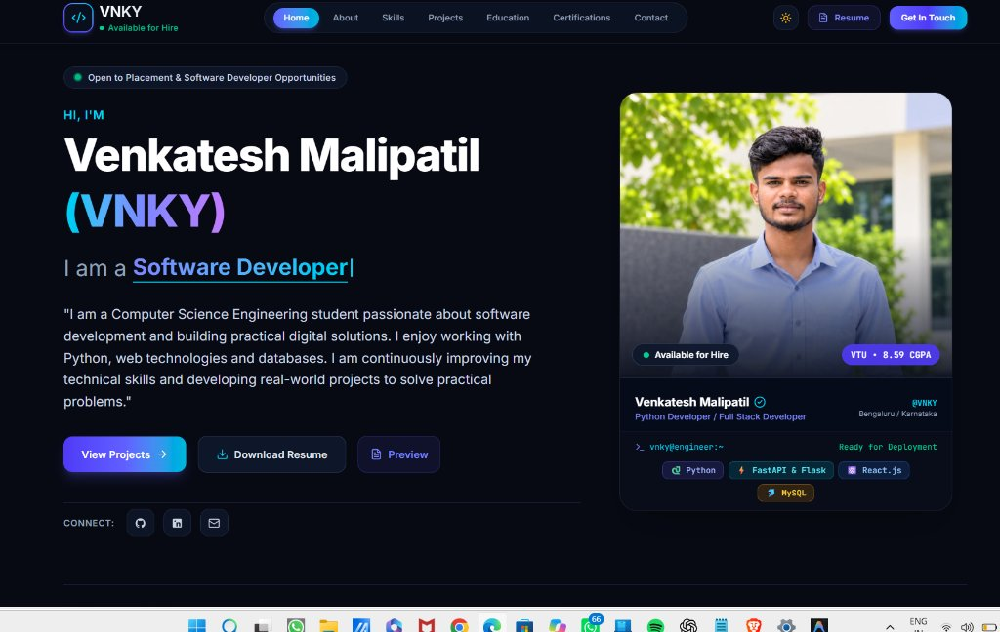

# 🚀 Premium Personal Developer Portfolio — Venkatesh Malipatil (VNKY)

<p align="center">
  
</p>

<p align="center">
  
  
  
  
</p>

A modern, responsive, high-performance developer portfolio website designed for a Computer Science Engineering graduate targeting roles as a **Python Developer** or **Full Stack Developer**.

Built with **React.js**, **Tailwind CSS**, and **Vite**, featuring a dark-first aesthetic, rich typography, interactive modal previews, real-time contact validation, and centralized data management.

---

## 🌟 Key Features

* **Modern Dark-Themed Interface**: Sleek deep navy/black obsidian background (`#070a13`) with cyan and electric indigo gradient accents, plus an instant dark/light mode toggle with `localStorage` persistence.
* **Animated Typewriter Effect**: Dynamic headline cycling through `Python Developer | Full Stack Developer | FastAPI & Flask Specialist | Software Developer`.
* **Real-World Project Showcase**:
  1. **AI-Powered Training & Placement Management System (AITPMS)**: Academic major project with multi-modal AI mock interviews, YOLOv8 vision integrity monitoring, and ReportLab PDF report generation.
  2. **Smart Expense Tracker**: Personal finance platform featuring OpenCV receipt preprocessing, RapidOCR ONNX extraction, Scikit-Learn TF-IDF categorizer, and Isolation Forest anomaly detection.
  3. **AI Travel Planner**: Flask and MySQL application with customized trip planning, attraction recommendations, and persistent trip history.
* **Proficiency-Based Skills Matrix**: Honest, recruiter-friendly proficiency indicators (`Advanced`, `Proficient`) with capability tags, strictly avoiding artificial skill percentages.
* **Editable Education & Academics**: Displays degree from **Visvesvaraya Technological University (VTU)**, CGPA 8.59, coursework, and PU college history. Fully editable via a single data file.
* **Interactive Certificate Studio**: Preview certifications (Python, SQL) with built-in client-side file upload support allowing you to drop and preview your own certificate PDF or image in real time.
* **In-Browser Interactive Resume Viewer**: Built-in modal allowing recruiters to inspect the full resume immediately or download the official `Venkatesh_Malipatil_Resume.pdf`.
* **Contact Form with Real-Time Validation**: Field validation for name, email, subject, and message, with copy-email quick button and mailto client launch options.
* **SEO Optimized & Responsive**: Pre-configured with meta tags, OpenGraph attributes, custom SVG favicon, and mobile navigation drawer.

---

## 📁 Project Structure

```
PORTFOLIO/
├── public/
│   ├── avatar.jpg                     # Profile image
│   ├── preview.jpg                    # Full UI preview screenshot for GitHub README
│   ├── favicon.svg                    # Custom VNKY brand favicon
│   └── Venkatesh_Malipatil_Resume.pdf # Downloadable resume PDF
├── src/
│   ├── assets/                        # Static icons and assets
│   ├── components/
│   │   ├── Navbar.jsx                 # Glassmorphism header with active link tracking
│   │   ├── Hero.jsx                   # Hero section with animated roles & terminal
│   │   ├── About.jsx                  # Bio, CSE background & 4 core engineering pillars
│   │   ├── Skills.jsx                 # Technical skills cards with proficiency levels
│   │   ├── Projects.jsx               # Projects showcase with category filtering
│   │   ├── ProjectModal.jsx           # Deep-dive architecture & features modal
│   │   ├── Education.jsx              # VTU degree timeline & academic achievements
│   │   ├── Certifications.jsx         # Certifications with live file upload preview
│   │   ├── CertificateModal.jsx       # Modal to preview certificate files
│   │   ├── Contact.jsx                # Validated contact form & direct reach-out
│   │   ├── ResumeModal.jsx            # In-browser CV viewer & print utility
│   │   ├── BackToTop.jsx              # Floating smooth scroll-to-top button
│   │   ├── Footer.jsx                 # Footer with quick links & copyright
│   │   └── SocialIcons.jsx            # Scalable GitHub and LinkedIn SVG components
│   ├── context/
│   │   └── ThemeContext.jsx           # Dark / Light theme provider & local storage
│   ├── data/
│   │   └── portfolioData.js           # ⚙️ ALL editable personal information & content
│   ├── App.jsx                        # Main application container
│   ├── index.css                      # Tailwind CSS v4 styling & animations
│   └── main.jsx                       # React DOM entrypoint
├── index.html                         # HTML template with SEO meta tags & Google Fonts
├── package.json                       # Project scripts and dependencies
├── vite.config.js                     # Vite build configuration with Tailwind plugin
└── README.md                          # Documentation & deployment guide
```

---

## 🛠️ Installation & Local Development

### 1. Prerequisites
Ensure you have **Node.js** (v18 or higher) installed:
```bash
node -v
npm -v
```

### 2. Install Dependencies
```bash
npm install
```

### 3. Run Development Server
```bash
npm run dev
```
Open your browser and navigate to `http://localhost:5173/`.

### 4. Build for Production
```bash
npm run build
```
This generates a production-optimized build in the `dist/` folder.

### 5. Preview Production Build Locally
```bash
npm run preview
```

---

## ⚙️ How to Update Personal Information

All information on the website is centralized in one easy-to-edit configuration file:

👉 **`src/data/portfolioData.js`**

Open this file to customize:
* **Personal Info**: Name, alias (`VNKY`), tagline, status badge, avatar.
* **Education**: College name (`K.N.S Institute of Technology`), university (`VTU`), graduation year (`2025`), and CGPA (`8.59`).
* **Contact Details**: Email (`venkateshmalipatil188@gmail.com`), LinkedIn URL, GitHub profile.
* **Technical Skills**: Add, edit, or adjust proficiency badges and framework tags.
* **Projects**: Update project summaries, features, GitHub repository links, or live demo URLs.
* **Certifications**: Modify titles, issuers, and skills gained.

### Replacing Resume and Avatar
* **Resume PDF**: Replace `public/Venkatesh_Malipatil_Resume.pdf` with your updated PDF.
* **Avatar Image**: Replace `public/avatar.jpg` with your profile picture.

---

## 🚀 How to Deploy Using Vercel

### Method A: Deploy via GitHub (Recommended)
1. Initialize git and commit your files:
   ```bash
   git init
   git add .
   git commit -m "Initial commit of V3NKEY portfolio"
   ```
2. Create a new repository on GitHub (e.g. `portfolio`) and push your code:
   ```bash
   git remote add origin https://github.com/venkateshmalipatil222-oss/portfolio.git
   git branch -M main
   git push -u origin main
   ```
3. Go to [vercel.com](https://vercel.com) and log in with your GitHub account.
4. Click **"Add New"** > **"Project"**.
5. Select your `portfolio` repository from the list.
6. In the project settings:
   * **Framework Preset**: Vite
   * **Root Directory**: `./`
   * **Build Command**: `npm run build`
   * **Output Directory**: `dist`
7. Click **"Deploy"**. Vercel will build and assign you a free production URL (e.g., `vnky-portfolio.vercel.app`) with automatic SSL and continuous deployment!

### Method B: Deploy using Vercel CLI
1. Install Vercel CLI globally:
   ```bash
   npm install -g vercel
   ```
2. Run deployment command in the project root:
   ```bash
   vercel
   ```
3. Follow the CLI prompts to link and deploy your project.
4. For production deployment:
   ```bash
   vercel --prod
   ```

---

## 👨‍💻 Author

* **Venkatesh Malipatil (VNKY)**
* **Email**: [venkateshmalipatil188@gmail.com](mailto:venkateshmalipatil188@gmail.com)
* **GitHub**: [@venkateshmalipatil222-oss](https://github.com/venkateshmalipatil222-oss)
* **LinkedIn**: [venkatesh-malipatil](https://linkedin.com/in/venkatesh-malipatil-266013380)
